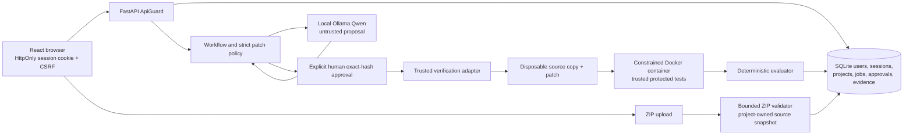

# SENTINEL-X final local architecture

## Trust boundaries

The browser is untrusted. It never receives the operator token or Neatlogs key. Individual passwords are hashed with Argon2id. Browser session identifiers are random; SQLite stores only SHA-256 hashes. The cookie is HttpOnly and SameSite=Lax, with Secure when the backend is reached over HTTPS. A separate CSRF token is required for state-changing session requests. CORS allows the configured frontend origin and its loopback hostname alias.

Uploaded ZIPs are untrusted. The API enforces archive, extracted, per-file, count and compression-ratio limits; rejects absolute/traversing paths, duplicate names and symlinks; and extracts into a per-project temporary directory before an atomic rename. The project owner is checked for every project and job route. Uploaded source is immutable through the API after import. The original ZIP is not retained; archive filename, hash, upload time, framework and source revision are stored. Source files remain local and are excluded from source control.

The supported profile is **`bola-required-tests-v1`**, an explicitly constrained Python/FastAPI document-access contract. It requires `app/access.py` with `get_document` and `app/sample_data.py`, plus a FastAPI dependency declaration. `app/access.py` is the only AI context and patch target. Uploading a repository does not scan it for vulnerabilities. Other frameworks are imported as `UNSUPPORTED` and cannot start remediation.

## Uploaded project verification

1. An authenticated owner supplies the BOLA finding. The job binds the owner, project ID, current source revision and trusted profile.
2. The backend reads only bounded `app/access.py` source. An obvious embedded-credential pattern blocks the context. The local Qwen model supplies a two-line ownership guard. The parser and AST checks produce a unified diff; the backend's path and diff policy remains authoritative.
3. The UI shows the exact diff and SHA-256 patch hash. A human explicitly approves that hash. The approval row binds the source revision, patch ID, attempt, project ID and individual user identity.
4. The verifier rechecks approval and source revision, copies only the contract source files into a disposable workspace, applies only the approved diff, and starts the trusted Docker image. The uploaded Dockerfile, scripts, dependencies and tests are never invoked. The protected test suite comes from `verification/protected_tests` and is mounted read-only.
5. Docker runs as a non-root image user with no network, limited CPU/memory/processes, dropped capabilities, no new privileges, a read-only base filesystem and bounded temporary/report mounts. No Docker socket or host secrets are mounted. The evaluator requires all eight named protected tests and reconciles per-test records with counts and process status.
6. The backend persists the verdict, timestamps, test counts, sanitized test names/outcomes, exact patch/source/profile binding and an evidence digest. A `VERIFIED` conclusion requires a matching active approval, current source, complete passing test report and valid attestation. Failed tests cause `VERIFICATION_FAILED`; infrastructure issues cause `EXECUTION_ERROR`.
7. A failed test run can pass sanitized failed test identifiers to Agent B for up to two revisions. Each revision produces a new patch attempt and needs a new human approval. No model can set the verifier verdict.

## Limits

This is a controlled local demonstration, not a general vulnerability scanner or production service. The single profile uses fixed trusted tests and a narrow source contract. In-process planning lacks durable distributed execution. Credential detection in source context is a bounded heuristic, so owners must remove secrets before uploading. Raw untrusted test logs and failure tracebacks are withheld; test names/outcomes and failed identifiers are exposed. Hosted Neatlogs delivery was not verified in this run.
