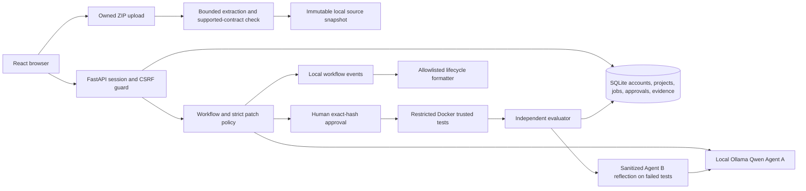

# SENTINEL-X Phase 8 local architecture

## Identity and source boundary

Passwords use Argon2id. Random session tokens are stored only as hashes; cookies are HttpOnly and SameSite, with Secure on HTTPS. State-changing requests require CSRF. Every project, job, patch, event and evidence read is owner scoped. The legacy operator token works only for the bundled demo target and cannot read user projects.

ZIPs are bounded by compressed size, total expanded size, file count, per-file size and compression ratio. Traversal, symlinks, duplicate paths, sensitive file types and corrupt archives are rejected. Extraction uses a per-project temporary directory and atomic move. Uploaded source is not executed on the host. The supported contract is the Python/FastAPI document access BOLA profile, `bola-required-tests-v1`; unsupported repositories may be stored but cannot enter this remediation workflow.

## Proposal, approval and verification

Only bounded `app/access.py` context reaches local Qwen. Agent A produces an untrusted proposal. Parsing, AST checks and strict patch policy bind the one allowed file and current source revision. A user sees the diff and SHA-256 hash before deciding. Approval binds user, source revision, attempt, patch ID and exact hash. A changed revision or patch needs a new approval.

The verifier copies only trusted contract source into a disposable workspace, checks approval and hash again, applies the patch with the host `patch` utility, then runs trusted protected tests inside a non-root Docker image. The container has no network, limited CPU, memory and processes, dropped capabilities, no new privileges, a read-only base filesystem and no Docker socket mount. The evaluator requires all eight named tests and reconciles counts, exit status, profile, source revision, patch hash and run attestation. Verdicts and evidence persist in SQLite; raw untrusted test logs are not exposed to Agent B.

When trusted tests fail, the backend sanitizes failed test identifiers and counts. Agent B validates and converts that feedback into bounded guidance for a fresh Agent A proposal. Local `REFLECTION_STARTED` and `REFLECTION_COMPLETED` events persist the attempt and safe feedback. At most two revisions are allowed. Each new proposal returns to human approval; Agent B cannot approve a patch or change the verifier verdict.

## Observability and operational boundary

The local workflow event store holds job and run correlation. A pure lifecycle formatter limits proposed outbound event names and fields; it has no exporter attached. The existing Neatlogs Agent A observer remains unchanged. Additional hosted lifecycle export awaits explicit owner approval of the exact payload. The `/ready` endpoint checks critical local dependencies with short timeouts; `/health` only confirms the API process is alive. Neatlogs is optional and its configured state does not imply delivery.

This is a controlled local demonstration. It is not a general repository scanner or a production deployment. Production mode remains disabled; TLS termination, durable workers and enterprise operations are outside this release.
